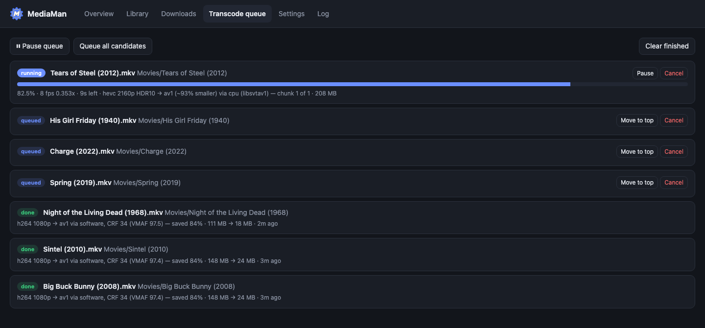

# MediaMan

A self-hosted media manager for a TrueNAS box running **Jellyfin** (or Emby, which uses the same
folder layout). It sees the same folders as your media server and download client, and:

- **Scans your existing library**, works out what each file is, and proposes Jellyfin-correct folder
  and file names. Nothing moves until you approve (or choose to rename automatically above a
  confidence level).
- **Watches your download client's finished folder.** Any client works: MediaMan waits until a
  download's files stop changing. A new download is identified and **copied** (or hardlinked) into
  the right library folder under its Jellyfin name, subtitles included. The original stays put so
  it keeps seeding. With qBittorrent's Web UI connected, it also waits until qBittorrent reports the
  download complete.
- **Runs a transcode queue** that shrinks files while keeping their resolution, HDR (HDR10, HDR10+,
  Dolby Vision), every audio track and every subtitle, aiming at a VMAF quality target. It checks
  each result before replacing the original.

**Hardware encoding:** software (CPU) encoding is what's been used most. AMD VAAPI has been tested
on real hardware; Intel QSV and NVIDIA NVENC are supported by the bundled ffmpeg but haven't been
tested on real hardware yet. Reports are welcome.

**Language:** folder and file names follow Jellyfin's English conventions (`Season 01`, `Extras`,
`Specials`).



More: [Overview](docs/screenshots/1-overview.png) · [Library](docs/screenshots/2-library.png) ·
[Downloads](docs/screenshots/3-downloads.png)

## How identification works

Each file gets a confidence score built from every hint available:

| Hint | Example |
|---|---|
| IDs already in the path | `Heat (1995) [imdbid-tt0113277]`, `{tmdb-603}` |
| `.nfo` files | `movie.nfo`, `tvshow.nfo`, `<episode>.nfo` (Kodi/Jellyfin XML or scene NFO with an IMDb link) |
| Existing library structure | `Shows/The Office (US)/Season 2/03 - Office Olympics.mkv` |
| Release / file names | `Severance.S01E03.1080p.ATVP.WEB-DL…`, season-pack folder names (via `guessit`) |
| Embedded tags | `show`, `season_number`, `episode_sort` |
| TMDb, asked through Jellyfin | Confirms the title and year and adds `[tmdbid-…]`, using Jellyfin's own TMDb search (no TMDb account needed) |
| Existing library folders | Reuses `The Office (US) (2005) [tvdbid-73244]` so you don't get a duplicate series folder |

Samples, `Extras/`-style folders, and files under the minimum size are skipped. Downloads under the
auto-import confidence threshold (default 0.75) wait in **Downloads** for you to correct and import.

### Naming

```
Movies/Title (Year) [tmdbid-N]/Title (Year)[ - Edition][ - partN].ext
Shows/Series (Year) [tvdbid-N]/Season 01/Series S01E02[-E03][ - Episode Title].ext
Shows/Series/Season 00/Series S00E01.ext        (specials)
```

Sidecar subtitles move with the video. `Movie.en.forced.srt` keeps its language and flags, and
release-group `Subs/2_English.srt` becomes `Title (Year).en.srt`. When a movie is the only video in
its folder, the folder artwork (`poster.jpg`, `fanart.jpg`, `movie.nfo`, …) moves with it.

## Transcoding

The defaults are tuned for Blu-ray/UHD remuxes: keep the source resolution, use the most efficient
codec that keeps every bit of HDR, and target "no visible loss".

**Codec per title (`Codec = auto`):**

| Source | Output | Why |
|---|---|---|
| SDR, HDR10, HLG | AV1 (SVT-AV1, 10-bit) | most efficient; mastering display + MaxCLL/MaxFALL kept |
| Dolby Vision 8, profile 7 MEL | HEVC (x265) Dolby Vision **8.1** | the DV form today's TVs play; HDR10 base kept |
| Dolby Vision profile 7 FEL | left alone (default) | its full enhancement layer is real extra picture detail that a single-layer file can't keep. Settings → Dolby Vision `convert` converts these too |
| HDR10+ | HEVC (x265) + HDR10+ | dynamic metadata extracted and re-injected with `hdr10plus_tool`, remuxed with `mkvmerge` |
| DV profile 5, already-efficient HEVC/AV1 | left alone | |

Whether a profile 7 file is FEL or MEL is read from its first frames with `dovi_tool` when the file is
scanned; the Library shows it (e.g. `DV7 FEL`).

HDR titles always use the CPU encoders: GPU encoders can't carry the HDR metadata.

**Quality:** with `vmaf` available, each title gets a short quality search. Four 8-second samples
are encoded at candidate CRFs and scored with Netflix VMAF (4K model for UHD). The highest CRF whose
weakest sample still reaches the target (default 95, visually lossless) wins. VMAF over-rates dark
HDR scenes, so HDR titles have a CRF ceiling: x265 ≤ 22, AV1 ≤ 28. A grainy film lands lower; for
example, *Goodfellas* got CRF 19.

**Streams:** every audio track is copied bit-for-bit, so TrueHD Atmos, DTS-HD MA, channel layouts,
languages and titles are unchanged. Every subtitle track, chapter and font is copied with its
language and default/forced flags. MP4 `mov_text` becomes SRT; broadcast caption streams are dropped.

**Before the original is replaced**, the result must have:

- a video stream, with a duration within 1% of the source
- for chunked encodes, exactly the source's frame count
- the same audio tracks and channel counts, and the same number of subtitle tracks
- the same HDR transfer, plus the mastering display, Dolby Vision and HDR10+ metadata where the source had them
- for Dolby Vision, profile 8. The Dolby Vision metadata isn't passed through the encoder: `dovi_tool`
  reads it from the original, converts it to 8.1 (`-m 2`, the standard conversion) and adds it to the new
  video frame for frame. That works for every disc layout, including discs whose enhancement layer is
  stored as Matroska block additions. A single-layer file whose metadata still describes profile 7 often
  plays as plain HDR10, which is why profile 8 is required.
- the HDR10 light levels (MaxCLL/MaxFALL), where the source had them
- a size at least `min savings` smaller

If any of these fail, the result is thrown away and the original stays. If they pass, the result
replaces the original under the same name (non-MKV sources become `.mkv`). The original is then
deleted, or moved to `.mediaman-trash` when *Keep originals* is on. Files in the downloads folder
are never transcoded.

**Performance note:** x265's automatic NUMA thread-pool setup fails inside Docker, which disables
its thread pool and wavefront parallelism. MediaMan passes `pools=<cpu count>` explicitly, which is
about 3.4× faster on a 24-thread Ryzen.

**Resumable encodes:** CPU encodes of constant-frame-rate video (nearly every remux) are written in
2-minute chunks to a hidden `.<name>.mediaman-work` folder next to the file. If MediaMan restarts
(a redeploy, NAS reboot or app update), the job goes back into the queue and resumes after the last
finished chunk; the quality search isn't repeated. When the last chunk is done, the chunks are
joined, HDR10+ metadata is injected if the source had it, and mkvmerge adds the source's audio,
subtitles, chapters and fonts back (it also writes the Dolby Vision configuration). mkvmerge stores
three-letter languages in their bibliographic form (`fre`, `ger`), which Jellyfin treats the same.
GPU encodes, variable-frame-rate video and AV1 Dolby Vision still run as a single encode.

**Pausing:** *Pause queue* freezes the running job on the spot (its encoder uses no CPU) and starts
nothing new; *Resume queue* continues it from the same frame. The pause is saved, so it survives a
restart. A job can also be paused on its own. Outside the *Only run between* window (e.g.
`01:00-07:00`) the running job is frozen the same way and continues when the window opens.
Cancelling a job deletes its work folder, and so does a job that turns out to be skipped (for example
after a settings change). The daily clean-up also removes any work folder that no waiting job will use
and that hasn't been touched for 2 days, so a failed job retried within that time still resumes.

**Restarts and shutdowns:** stopping the app, restarting the app pool or shutting down the NAS sends
MediaMan the normal container stop signal. It shuts down in about a second and keeps the finished
chunks, so a chunked encode resumes from its last finished chunk (at most 2 minutes of video is
re-encoded). Single-pass encodes (GPU, variable frame rate, AV1 Dolby Vision) start again from the
beginning. With **Resume transcoding after a restart** off (Settings → Transcoding), the queue comes
back paused instead and waits for *Resume queue*. A queue you paused yourself stays paused either way.

**Stall watchdog:** ffmpeg with SVT-AV1 can occasionally deadlock (seen at the end of a chunk): the
process stays alive and keeps reporting progress, but no new frames come out. An encoder that produces
no new frame for 10 minutes while not paused is stopped. A chunk is then retried (up to 3 tries); a
single-pass encode moves on to its next attempt.

## Install on TrueNAS (Community Edition 25.04+)

MediaMan is in the TrueNAS apps catalog (community train).

1. **Apps → Discover Apps**, search for **MediaMan**, and click **Install**.
2. Fill in the form:
   - **Configuration Storage** holds MediaMan's settings, database and logs. The default ixVolume is fine.
   - **Media Storage** defaults to an ixVolume, which is a new, empty dataset. For an existing library,
     change **Type** to **Host Path** and pick the one folder that contains your Jellyfin Movies and
     Shows folders and your finished downloads. It's mounted at `/media`, and a single mount lets
     imports use hardlinks. Add other pools or datasets under **Additional Storage**.
   - **WebUI Port** defaults to 30579.
   - **Certificate** (optional) serves the web UI over HTTPS with one of TrueNAS's certificates.
   - **Resources**: the defaults (2 CPUs, 4 GB) are enough for organizing and importing. For 4K
     transcodes, give it 8 or more CPUs and 8–16 GB, and pass through a GPU if you have one.
3. Click **Web UI** on the installed app. A setup wizard walks through:
   - the folders, picked with **Browse…** from what's mounted, each checked for write access
   - Jellyfin and qBittorrent, each with a Test button
   - the automation and safety settings
   - an optional password

   Nothing is imported or renamed until it's finished or skipped. **Settings → Run the setup wizard
   again** reopens it.
4. Check **Overview → Folders** (each one should show *writable*) and **Hardware**.

### Install via YAML instead

To run the published image (`ghcr.io/mjwaters1985/mediaman`) as a custom app:

1. Copy [`truenas/mediaman.yaml`](truenas/mediaman.yaml).
2. Replace the `/mnt/POOL/...` paths with:
   - a folder for MediaMan's config and database
   - the folder that holds your Jellyfin Movies and Shows folders and your finished downloads,
     mounted at `/media`

   Check the `group_add` IDs with `ls -ln /dev/dri`. For NVIDIA, use the commented `deploy` block.
3. **Apps → Discover Apps → ⋮ → Install via YAML**, name it `mediaman`, and paste the YAML.
4. Open `http://<nas>:8765` and follow the setup wizard as above.

To run your own build instead (development), copy the repository to the NAS, run
`sudo sh truenas/build-on-nas.sh` (it builds `mediaman:latest`), and in the YAML use
`image: mediaman:latest` with `pull_policy: never`.

### Several pools or datasets

- **More Movies / TV folders** (Settings → Folders) adds library folders on other pools or datasets,
  like the extra folders in a Jellyfin library. They're scanned as Movies or TV. A title goes to the
  folder that already has it (a series is never split across pools); a new title goes to the main
  folder; a file already in one of the extra folders stays there.
- **Hardlinks** only work within one dataset *and* one mount. Between datasets MediaMan copies
  instead and logs why. A move between datasets is a copy followed by a delete.
- **Free space** is checked before copying into a dataset (file size + 2 GB) and before a transcode
  (about twice the expected new file, because work files sit next to the source). Quotas count.
  Overview → Folders shows each folder's free space.
- **Keep originals**: the replaced file goes to `.mediaman-trash` at the top of the library folder,
  or next to the file when it's on its own dataset (e.g. `Movies/4K`).

### Logs

The Log tab keeps the newest 5,000 entries. A daily clean-up also drops expired title lookups and
cached file details for files that no longer exist. Each entry is also printed once to the app's
TrueNAS log; TrueNAS doesn't rotate container logs, so MediaMan never prints encoder output there.

### Sharing the NAS

- **CPU and memory limits** set for the app in TrueNAS are respected: encoder thread counts come from
  the container's real limit, not the host's core count. The AV1 encoder's memory grows with its
  parallelism (about 3 GB at the lowest level and 6 GB at level 4 for a 4K encode; its own automatic
  setting reached 18 GB on a 24-thread machine), so MediaMan picks the highest level that fits in half
  the memory limit, shared between parallel jobs. Overview → Hardware shows the CPUs and memory it sees.
  The limits can only be changed in TrueNAS (*Apps → MediaMan → Edit → Resources Configuration*). When
  they're too low for 4K transcodes (under 4 CPUs, or too little memory for the AV1 encoder), Overview and
  the Transcode queue say so and suggest how much to give it. The catalog defaults (2 CPUs, 4 GB) are
  enough for organizing and importing; for 4K transcodes, 8 or more CPUs and 8–16 GB work well.
- **Encoder priority** (Settings → Transcoding, default *low*): encoders run at `nice 10` and the lowest
  best-effort disk priority, so file shares and Jellyfin playback stay responsive. Encodes only slow
  down while the NAS is busy with something else.
- **GPU**: with *GPU render node* empty, MediaMan tests each GPU at startup and uses the one whose
  encoders work (on a machine with an integrated and a dedicated GPU that isn't always `renderD128`).
- **Jellyfin** is told exactly which files changed (`/Library/Media/Updated`), at most once a minute,
  instead of rescanning the whole library. MediaMan matches its folders to Jellyfin's by name, since
  the two apps usually see the library under different paths (e.g. `/data/Media/Movies` and
  `/Media/Movies`); if a file can't be matched, it falls back to a full library refresh.
- **New-install defaults** are the cautious ones: Keep originals on, transcoding imports off, profile 7
  FEL left alone. An existing install keeps whatever it had.

### Password

**Settings → Web UI password** turns on a password for the web UI (the browser asks for it; any user
name works). It's stored as a salted scrypt hash in `auth.json` in the config folder, never in plain
text. Changing or removing it needs the current password. Forgotten it? Delete `auth.json` from the
config folder and restart the app. `/healthz` stays open for the container health check.

### HTTPS

In the catalog app, pick a **Certificate** in the app's settings. TrueNAS hands it to MediaMan,
which is all that's needed.

For a YAML install, set `MEDIAMAN_TLS_CERT` and `MEDIAMAN_TLS_KEY` to a PEM certificate (full chain) and key that
the container can read. The UI is then served over HTTPS on the same port. MediaMan checks the
files every 5 minutes. When a renewal tool replaces them, it waits until no transcode, scan or
import is running, checks the new pair loads, and restarts itself onto it. If the files are
missing or don't load at startup, it falls back to plain HTTP and shows the reason on the
Overview tab, so a bad path can't lock you out.

### Permissions

The container runs as `568:568` (TrueNAS's `apps` user, the same user the Jellyfin and qBittorrent
apps use). That user needs write access to the library folders and read access to the downloads
folder. MediaMan never runs `chmod`/`chown`, and copies don't preserve the source permissions, so
new files inherit the library dataset's ACL. This matters on SMB/ACL-managed datasets, where
`chmod` is refused.

In the catalog app, TrueNAS's permissions helper only sets up storage that's still empty, such as a
new ixVolume; it skips folders that already have files in them, so an existing library keeps its
owners and ACLs.

### Copy vs hardlink

The default `copy` works across any mounts. `hardlink` saves space but only works when downloads
and the library are on the **same** host-path mount inside the container. If you want that, mount
a common parent folder once and point the three folder settings at subfolders. Transcoding replaces
the library file with a new one, so a hardlinked download is never affected.

## Development

The screenshots in `docs/screenshots/` come from a demo library of open-licence and public-domain
titles with synthetic video; `tools/make-demo-library.sh` recreates it.

```sh
docker build -t mediaman:dev .
docker run --rm -v "$PWD":/src -w /src mediaman:dev sh -c "pip install -q pytest && python -m pytest -q tests"
./run-test.sh          # runs the app against ./testdata on http://localhost:8765
```

The end-to-end check of chunked encodes (interrupt and resume, exact frame count, no shifted frames at
the joins, HDR10, Dolby Vision 8, audio, subtitles, chapters, and Pause queue freezing a job) uses real
encoders and takes a few minutes:

```bash
docker run --rm -v "$PWD":/src:ro --entrypoint python mediaman:dev /src/tests/integration_chunked.py
```

The code lives in `app/`: `identify.py` (hints), `naming.py` (Jellyfin paths and sidecars),
`organizer.py` (scan, propose, apply), `watcher.py` (downloads), `transcode.py` (hardware
detection, planning, queue), `integrations.py` (Jellyfin lookups and refresh, qBittorrent), `main.py` (API), and
`static/` (UI).

## Support

MediaMan is a free, one-person project. Problems and ideas go in
[GitHub issues](https://github.com/MJWaters1985/MediaMan/issues). If it saves you time or disk space,
you can [buy me a coffee](https://buymeacoffee.com/mjwaters1985).

## License

Copyright (C) 2026 Mike Waters ([@MJWaters1985](https://github.com/MJWaters1985))

MediaMan is free software: you can redistribute it and/or modify it under the terms of the GNU General
Public License as published by the Free Software Foundation, either version 3 of the License, or (at
your option) any later version (`GPL-3.0-or-later`). It is distributed in the hope that it will be
useful, but WITHOUT ANY WARRANTY; see [LICENSE](LICENSE) for the full text.

### Software bundled in the container image

The image installs these tools unmodified from their publishers; their source code is available from
the links below.

| Component | License | Source |
|---|---|---|
| jellyfin-ffmpeg 7 (FFmpeg built with GPL v3 parts, incl. x264, x265, SVT-AV1) | GPL-3.0 | [jellyfin/jellyfin-ffmpeg](https://github.com/jellyfin/jellyfin-ffmpeg) |
| MKVToolNix (Debian package) | GPL-2.0-or-later | [mkvtoolnix.download](https://mkvtoolnix.download/source.html), [Debian sources](https://sources.debian.org/src/mkvtoolnix/) |
| VMAF | BSD-2-Clause-Patent | [Netflix/vmaf](https://github.com/Netflix/vmaf) |
| dovi_tool | MIT | [quietvoid/dovi_tool](https://github.com/quietvoid/dovi_tool) |
| hdr10plus_tool | MIT | [quietvoid/hdr10plus_tool](https://github.com/quietvoid/hdr10plus_tool) |
| Python 3.12 and Debian base packages | various free licenses | [Debian sources](https://sources.debian.org/) |

Python dependencies are listed in `requirements.txt` with their versions.
